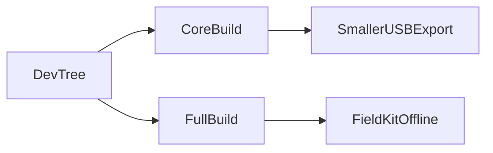

# Plan: Bundle size, slim builds, and faster USB/deploy

**Scope:** Install size, cold start, and **downstream** effects on Aegis USB export (copying the whole app).  
**Related plans:** [ui-app-wide.md](ui-app-wide.md) (lazy loading, `manualChunks`), [quality-testing-and-bugs.md](quality-testing-and-bugs.md) (CI must still test slim vs full if split).

---

## Goals

- Smaller **download / install** artifacts where product allows.
- Faster **first open** (less JS parse, fewer resources to validate at launch).
- Shorter **USB copy time** by reducing what sits inside the `.app` / install tree (long-term; requires build or export strategy).

---

## Current state (grounded)

### Tauri bundle — [`athena/src-tauri/tauri.conf.json`](../../athena/src-tauri/tauri.conf.json)

**`bundle.resources`**

- `resources/embedding`
- `resources/reranker`
- `resources/tessdata/*`
- `payload/**/*`

**`bundle.externalBin`**

- `bin/pmtiles`, `bin/tesseract`, `bin/pdftoppm`, `bin/kiwix-serve`, `ollama`

These dominate **disk footprint** on top of the compiled binary.

### Rust — [`athena/src-tauri/Cargo.toml`](../../athena/src-tauri/Cargo.toml)

- Optional feature **`piper-tts`** — use as a **template** for future optional subsystems (`default = []`).

### Frontend

- No **`manualChunks`** in [`vite.config.ts`](../../athena/vite.config.ts).
- Eager [`App`](../../athena/src/main.tsx) import pulls full graph.

---

## Workstream A — Frontend bundle

**Actions**

1. Align with [ui-app-wide.md](ui-app-wide.md): **lazy routes** + shared `Suspense` fallback.
2. Add `build.rollupOptions.output.manualChunks` for vendor splits (`maplibre-gl`, `pdf-lib`, `pmtiles`, `leaflet` cluster).
3. Measure: compare `dist/assets/*.js` sizes before/after; record in PR description.

**Acceptance:** Measurable drop in **largest initial chunk** or total main-thread parse (use build output as proxy).

---

## Workstream B — Tauri resources strategy

**Product decisions required**

| Strategy | Tradeoff |
|----------|----------|
| **Download on first run** | Smaller installer; needs network or offline fallback messaging. |
| **Split “Core” vs “Full” CI artifacts** | Two release names; docs must explain which to deploy in the field. |
| **Trim `payload/**/*`** | May remove offline curriculum/maps from default build—verify Academy / Archive requirements. |

**Actions**

1. **Baseline:** Script or doc table: size of each resource glob and each `externalBin` per OS target.
2. **Core build (example):** Omit optional payload subtrees; ship **manifest** listing optional packs downloadable later.
3. **Embedding/reranker:** If models are duplicated in `resources/` and user `data/`, dedupe strategy to avoid double storage.

**Acceptance:** One **documented** baseline table + one **measurable** artifact size reduction OR explicit product waiver in issue.

---

## Workstream C — Rust binary optimization

**Actions**

- Release profile: `strip = true`, LTO (`thin` or `fat`), sensible `codegen-units` (document in `Cargo.toml` `[profile.release]` or build scripts).
- Optional: `cargo bloat` or `cargo llvm-lines` on hot crates to find unexpected weight.

**Caution:** Measure **cold start** after LTO; sometimes link time grows.

---

## Workstream D — Sidecars and `externalBin`

**Actions**

- Audit `athena/src-tauri/bin/` (or documented sidecar paths): ensure **no duplicate architectures** shipped in one platform bundle.
- Confirm each binary is **required** for default station profile; move optional tools behind download or feature flag.

---

## Workstream E — USB Essentials alignment (product note)

**Fact:** Aegis **Essentials** still runs **`copy_application_to_destination`** — the **entire** install/bundle is duplicated first ([`portable.rs`](../../athena/src-tauri/src/portable.rs)).

**Implication:** UI copy that says “small tier” must clarify: **tier controls extra roots**, not stripping the app bundle.

**Engineering directions (longer-term)**

1. **Slim app build** (this doc, workstreams B–D).
2. **Selective copy allowlist** for portable export (risky; must not break runtime).
3. **Separate “runtime only” package** for USB (major architectural change).

Cross-link from Aegis / README when messaging changes.

---

## Artifact strategy (reference)

---

## Plan-level acceptance criteria

- [ ] **Baseline** sizes recorded (app bundle MB, resources MB, largest JS chunk).
- [ ] **One measurable reduction** per milestone (artifact or initial JS).
- [ ] Product sign-off documented before omitting `payload` or models from default build.

---

## Suggested execution order

1. Frontend `manualChunks` + lazy views (low product risk).  
2. Release profile + strip (build pipeline).  
3. Resource audit table + proposal for Core vs Full.  
4. Export messaging + optional selective copy (future epic).
